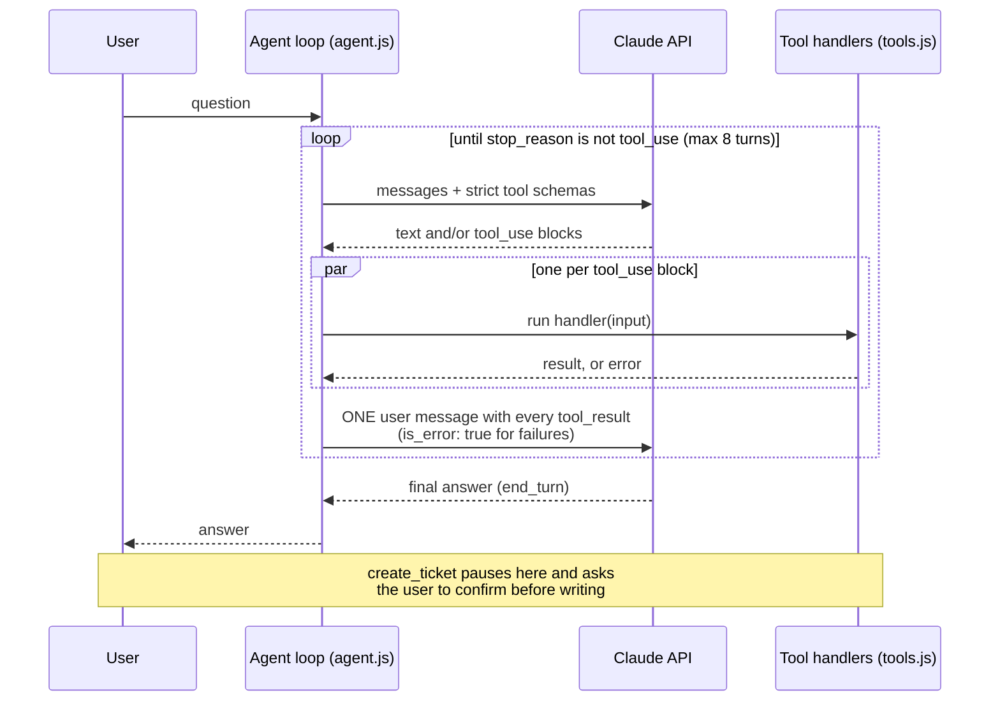

# claude-tool-use-assistant

A command-line IT-support assistant built on the Claude API with function calling. It does not only answer in text: it runs real DNS and HTTP checks, looks up asset records, searches a knowledge base, and files a ticket after the user confirms.

All data (assets, knowledge base, service status) is fictional. The DNS and HTTP tools make real network requests to public hosts.

## What it does

```text
you> Is example.org reachable, and what does its DNS say?
→ dns_lookup {"hostname":"example.org","record_type":"A"}
→ http_check {"url":"https://example.org"}

example.org resolves to 104.20.26.136 and 172.66.157.237, and https://example.org/
answered 200 in 315 ms with no redirects.
```

| Tool | Type | What it does |
|---|---|---|
| `lookup_asset` | read | Asset record by ID (e.g. `LT-1042`) |
| `search_kb` | read | Keyword search over troubleshooting articles |
| `check_service_status` | read | Status of an internal service (VPN, email, Wi-Fi…) |
| `dns_lookup` | read, live | A, AAAA, CNAME, MX, TXT or NS query |
| `http_check` | read, live | Status code, redirect chain, response time |
| `create_ticket` | **write** | Appends a ticket after a human confirms |

## How it works



The loop is written by hand rather than with an SDK helper, so each step is visible: append the assistant's full content to the history, run every `tool_use` block concurrently, return all results together, and stop on `end_turn`. `refusal`, `max_tokens` and a runaway loop are raised as errors.

## Stack

Node 22+, `@anthropic-ai/sdk`, `node:dns`, built-in `fetch`, `node:readline`, `node:test`. No other dependencies.

## Run it

```bash
git clone <this repo> && cd claude-tool-use-assistant
npm install
npm run demo          # scripted offline model, no API key; DNS and HTTP are still live
```

`npm run demo` asks the assistant to check `example.org` and raise a ticket for a laptop with a Wi-Fi problem, and auto-approves the ticket (`--yes`).

Interactive, with Claude:

```bash
cp .env.example .env  # set ANTHROPIC_API_KEY
npm start
```

Without a key the CLI falls back to the mock model automatically. The model defaults to `claude-opus-5-5`; set `ANTHROPIC_MODEL` to change it.

```bash
npm test              # 13 tests, no API key needed
```

Tickets are written to `src/data/tickets.json`, which is git-ignored.

## Design notes and what I learned

**Tool schemas are strict.** Every tool sets `strict: true`, `additionalProperties: false`, and lists all properties as required, so the model cannot send malformed arguments. Optional values use an empty string (`asset_id: ""`). A test checks every tool definition for this.

**Failures go back to the model, not up the stack.** A handler that throws becomes a `tool_result` with `is_error: true`. The model can then retry, try something else, or explain what failed. Unknown tool names are handled the same way.

**An empty answer is not an error.** `NXDOMAIN` and "no data" come back as a normal result with `records: []` and a `dns_error` code. Only real failures (timeouts, malformed input) are errors.

**The model chooses the hostname, so the network tools are restricted.** `http_check` and `dns_lookup` validate the hostname, allow only `http` and `https`, and resolve the host before connecting. Private, loopback, link-local and carrier-grade-NAT addresses are refused. Redirects are followed manually (maximum 3) and every hop is checked again, because a public URL can redirect to an internal one.

**Writes need a human.** `create_ticket` calls a `confirm` function before touching disk. The CLI prompts; `--yes` approves automatically. If the user declines, the tool returns an error telling the model not to retry, and the final answer says the ticket was not created. Tests cover both outcomes.

**Parallel calls go back in one message.** When the model asks for several tools at once, the results are returned together in a single user message, in the same order. A test pins this.

**No forced tool choice.** The newest models reject `tool_choice` of `any` or a specific tool, so requests use `auto`, strict schemas and a system prompt that says when to use tools.

**Tool output is treated as data.** The system prompt tells the model to ignore instructions that appear inside tool results.

**The mock model makes this testable.** `mock-llm.js` implements the same `messages.create` shape with keyword planning, so the loop, error handling and confirmation flow are tested without network access or an API key.

## Limits

- The mock model is keyword-based. It exists to exercise the code, not to imitate Claude's judgment.
- Conversation history grows without bound in the REPL. A long session would need trimming or compaction.
- The Claude path is covered by tests with a scripted client; it has not been run against the live API in this repository's test suite.

## Layout

```
src/agent.js       the tool-use loop
src/tools.js       tool schemas and handlers
src/net-safety.js  address checks for the network tools
src/mock-llm.js    offline stand-in for the Messages API
src/index.js       CLI (REPL, --ask, --mock, --yes)
src/data/          fictional assets, KB articles, service status
test/              node:test suites
```

## Licence

MIT
